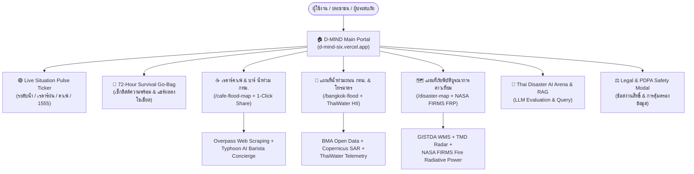
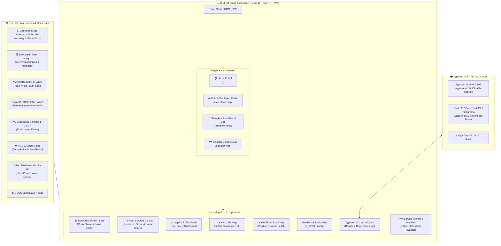

<div align="center">


# 🌊 D-MIND
### Disaster Management & Intelligence Network Dashboard
**แพลตฟอร์มบูรณาการข้อมูลและระบบเตือนภัยพิบัติอัจฉริยะสำหรับประเทศไทย ผสานพลังปัญญาประดิษฐ์และโทรสัมผัส**

[](https://d-mind-six.vercel.app/)
[](https://vitejs.dev/)
[](https://reactjs.org/)
[](https://www.typescriptlang.org/)
[](https://tailwindcss.com/)
[](https://leafletjs.com/)
[](https://opentyphoon.ai)
[](https://d-mind-six.vercel.app/)
[](https://firms.modaps.eosdis.nasa.gov/)
[](https://d-mind-six.vercel.app/)
[](LICENSE)

<br/>

### 🌐 บริการหลักและช่องทางเข้าใช้งานระบบจริง (Live Deployments)

| บริการ / หน้าแอปพลิเคชัน | URL เชื่อมต่อไปยังระบบจริง | รายละเอียดฟังก์ชันหลัก |
|---|---|---|
| 🏠 **หน้าหลัก D-MIND Portal** | **[d-mind-six.vercel.app](https://d-mind-six.vercel.app/)** | ศูนย์กลางบริหารจัดการและเตือนภัยพิบัติ, ดัชนีความเสี่ยงรายวัน, ข่าวสารฉุกเฉิน, Thai LLM Arena, RAG Assistant |
| 🟢 **แถบสถานะวิกฤตเรียลไทม์ (Live Pulse)** | **[d-mind-six.vercel.app](https://d-mind-six.vercel.app/)** | แถบพัลส์เฝ้าระวังระดับน้ำเจ้าพระยา, เรดาร์กลุ่มฝน กทม., เรดาร์คาเฟ่ปลอดภัย และสายด่วน กทม. 1555 ตลอด 24 ชม. |
| 🎒 **กระเป๋าฉุกเฉิน 72 ชม. (Go-Bag)** | **[d-mind-six.vercel.app](https://d-mind-six.vercel.app/)** | เช็กลิสต์อุปกรณ์ยังชีพ 8 หมวดหมู่ พร้อมระบบคิดคะแนนความพร้อม (Readiness Score) และ 1-Click Social Sharing |
| ☕ **เรดาร์คาเฟ่ & บาร์ น้ำท่วม กทม.** | **[d-mind-six.vercel.app/cafe-flood-map](https://d-mind-six.vercel.app/cafe-flood-map)** | เรดาร์ค้นหาร้านกาแฟ มัทฉะ บาร์ และที่นั่งทำงานที่เปิดให้บริการ ปลอดภัยจากน้ำท่วม พร้อม Typhoon AI และปุ่มแชร์ลง LINE |
| 🚦 **แผนที่น้ำท่วมถนน กทม. & จุดตรวจวัด** | **[d-mind-six.vercel.app/bangkok-flood](https://d-mind-six.vercel.app/bangkok-flood)** | แผนที่ติดตามเส้นทางถนนน้ำท่วม กทม. 3 ระดับสี, สถานีสูบน้ำระบายสู่เจ้าพระยา, ข้อมูลโทรมาตร สสน. และ Sentinel-1 SAR |
| 🗺️ **แผนที่ภัยพิบัติบูรณาการ (Disaster Map)** | **[d-mind-six.vercel.app/disaster-map](https://d-mind-six.vercel.app/disaster-map)** | แผนที่ดาวเทียม WMS GISTDA ทั่วประเทศ, NASA FIRMS Fire Radiative Power (MW), เรดาร์ฝน RainViewer, แผ่นดินไหว USGS |
| 🌋 **SeismoGuard AI (แผ่นดินไหว)** | **[d-mind-ai-earthquake-guard.vercel.app](https://d-mind-ai-earthquake-guard.vercel.app)** | ระบบนวัตกรรมประเมินและแจ้งเตือนคลื่นแผ่นดินไหวแบบ Real-time ด้วย AI (โครงการประกวด วช. NRCT) |

<br/>

<p align="center">
  <a href="#-1-หน้าหลัก-d-mind-portal">1. หน้าหลัก D-MIND</a> •
  <a href="#-2-เรดาร์คาเฟ่--บาร์-น้ำท่วม-กทม-bangkok-cafe--bar-flood-radar">2. เรดาร์คาเฟ่ & บาร์</a> •
  <a href="#-3-แผนที่น้ำท่วมถนน-กทม--โครงข่ายจุดตรวจวัด">3. แผนที่น้ำท่วมถนน กทม.</a> •
  <a href="#-4-นวัตกรรมความปลอดภัย-pwa--การตลาดไวรัล">4. ความปลอดภัย & ไวรัล</a> •
  <a href="#-system-architecture">สถาปัตยกรรมระบบ</a> •
  <a href="#-tech-stack">เทคโนโลยีที่ใช้</a> •
  <a href="#-getting-started">การติดตั้งและใช้งาน</a>
</p>

</div>

---

## 📖 บทนำ (Overview)

**D-MIND** (*Disaster Management & Intelligence Network Dashboard*) ได้รับการพัฒนาขึ้นเพื่อเป็นโครงสร้างพื้นฐานดิจิทัลด้านการเตือนภัยและรับมือภัยพิบัติสำหรับประชาชนและหน่วยงานในประเทศไทย โดยเชื่อมต่อข้อมูลสารสนเทศภูมิศาสตร์ (GIS), ภาพถ่ายดาวเทียมโทรสัมผัส (Remote Sensing), ข้อมูลโทรมาตรตรวจวัดระดับน้ำและสภาพอากาศแบบเรียลไทม์ และผสานพลังปัญญาประดิษฐ์โมเดลภาษาไทย **Typhoon LLM v2.5** เพื่อให้คำแนะนำที่แม่นยำ ปฏิบัติได้จริง และเข้าถึงได้ง่ายในยามเกิดวิกฤตสภาพอากาศ

---

## 🌟 จุดเด่นและระบบงานหลัก (Core Modules)



---

### 🏠 1. หน้าหลัก: D-MIND Portal
> **URL:** [https://d-mind-six.vercel.app/](https://d-mind-six.vercel.app/)

ศูนย์กลางข่าวสารและแดชบอร์ดติดตามภัยพิบัติระดับประเทศ ออกแบบตามมาตรฐาน **UI/UX Pro Max** รองรับโหมดมืด (Dark Mode) และโหมดสว่าง (Light Mode) อย่างสมบูรณ์:

1. **🟢 Live Crisis Situation Pulse (แถบพัลส์สถานการณ์สดเรียลไทม์):**
   - แสดงสถานะด่วน 4 มิติสำคัญที่ส่วนบนสุดของหน้าเว็บ: ระดับน้ำแม่น้ำเจ้าพระยา (ปกติ/ต่ำกว่าคันกั้นน้ำ), เรดาร์กลุ่มฝน กทม., จำนวนคาเฟ่ปลอดภัยที่เปิดให้บริการ (67+ แห่ง), และความพร้อมของศูนย์รับแจ้งเหตุน้ำท่วม กทม. 1555
2. **🎒 กระเป๋าฉุกเฉิน 72 ชั่วโมง (72-Hour Survival Go-Bag Interactive Checklist):**
   - เครื่องมือเตรียมความพร้อมภาคประชาชน ตรวจสอบอุปกรณ์ยังชีพจำเป็น 8 รายการ (น้ำดื่ม 3L/วัน, อาหารแห้ง/MRE, ยาประจำตัว, ไฟฉาย, พาวเวอร์แบงค์, เอกสารสำคัญกันน้ำ, นกหวีดฉุกเฉิน, เงินสดสำรอง)
   - คำนวณคะแนนความพร้อม **Readiness Score (0-100%)** แบบไดนามิก พร้อมบันทึกลง LocalStorage
   - ปุ่ม **"แชร์คะแนนความพร้อมให้เพื่อน"** รองรับ Web Share API และส่งต่อข้อความเข้าห้องแชต LINE เพื่อสร้างไวรัลและกระตุ้นการตื่นตัวรับมือภัยพิบัติ
3. **Live Emergency Announcement & Hero Banner:**
   - แสดงสถานะเฝ้าระวังมรสุมและฝนตกหนักแบบไดนามิก พร้อมปุ่มทางลัดด่วนสู่ทุกบริการหลัก
4. **ดัชนีชี้วัดสถานการณ์ฉุกเฉินรายวัน (Daily Disaster Indicators):**
   - ตรวจจับระดับความเสี่ยงประจำวัน สภาพฝนสะสม พื้นที่เสี่ยงน้ำหลาก และจุดความร้อนไฟป่า
5. **Thai Disaster AI Assistant & LLM Arena:**
   - ระบบสืบค้นข้อมูลภัยพิบัติด้วยเทคนิค **Retrieval-Augmented Generation (RAG)**
   - เวทีทดสอบและเปรียบเทียบประสิทธิภาพโมเดลภาษาไทยชั้นนำ:
     - `Typhoon-S 8B Instruct / v2.5 30B`
     - `OpenThaiGPT 8B v7.2`
     - `Pathumma 8B Think 3.0.0`
     - `THaLLE 0.2 8B FA`
     - `Google Gemini 1.5 / 2.0 Flash`
     - Local LLM via Ollama (`Nemotron-3`, `Gemma`)
6. **AI Damage Assessment (ระบบประเมินความเสียหายจากภาพถ่าย):**
   - วิเคราะห์ภาพถ่ายความเสียหายจากภัยพิบัติด้วยโมเดล Vision AI เพื่อคัดกรองระดับความเร่งด่วนในการช่วยเหลือ
7. **ศูนย์รับแจ้งเหตุประชาชน & รวบรวมสายด่วนฉุกเฉิน (Hotline Directory):**
   - รวมเบอร์โทรฉุกเฉินสำคัญ เช่น สายด่วน กทม. **1555**, กู้ชีพ **1669**, ดับเพลิง **199**, ตำรวจทางหลวง **1193** พร้อมฟังก์ชันคลิกโทรออกได้ทันที

---

### ☕ 2. เรดาร์คาเฟ่ & บาร์ น้ำท่วม กทม. (Bangkok Cafe & Bar Flood Radar)
> **URL:** [https://d-mind-six.vercel.app/cafe-flood-map](https://d-mind-six.vercel.app/cafe-flood-map)

โซลูชันนวัตกรรมที่ออกแบบมาเพื่อช่วยเหลือคนกรุงเทพฯ ในช่วงสัปดาห์มรสุมและฝนตกหนัก ค้นหาร้าน Specialty Coffee, ร้านมัทฉะ, ค็อกเทลบาร์, เบเกอรี่ และพื้นที่นั่งทำงาน (Coworking Space) ที่ **เปิดให้บริการจริง** และ **ปลอดภัยจากน้ำท่วมขัง**:

```
┌────────────────────────────────────────────────────────────────────────┐
│ ☕ Bangkok Cafe & Bar Flood Radar                                      │
├──────────────────────────────────┬─────────────────────────────────────┤
│ 🗺️ Interactive React-Leaflet Map  │ 🔍 Search & Multi-Filters Bar       │
│  - 60+ Curated Beloved Venues    │  - Categories: Coffee, Matcha, Bar, │
│  - Category Icon & Glow Halos    │    Bakery, Coworking, Pet-Friendly  │
│  - Flood Safe Halo (Green/Amber) │  - Zones: Inner, Outer, Thonburi,   │
│  - Flooded Roads Polyline Layer  │    Metropolitan Perimeter           │
│  - Bottom-right Zoom Control     │  - Day/Time: Live Open, Morning,    │
│  - Stacking Context Isolated     │    Afternoon, Evening, Custom Hour  │
│                                  │  - Toggle: Flood Safe Only / OSM    │
├──────────────────────────────────┴─────────────────────────────────────┤
│ 🌪️ Typhoon LLM AI Barista & Flood Weather Concierge (v2.5-30b)         │
│  - "วิเคราะห์ระดับน้ำขังรอบร้าน แนะนำเมนู และเส้นทางหลบฝนแบบเรียลไทม์"    │
├────────────────────────────────────────────────────────────────────────┤
│ 📲 1-Click Social Sharing Button (Web Share API & LINE Share)          │
│  - ส่งต่อข้อมูลร้านที่เปิด & ปลอดภัยเข้าห้องแชตเพื่อนร่วมงานทันที           │
└────────────────────────────────────────────────────────────────────────┘
```

#### คุณสมบัติเด่นของเรดาร์คาเฟ่ & บาร์:
- **ครอบคลุม 4 โซนหลักทั่วกรุงเทพฯ และปริมณฑล:**
  - **กทม. ชั้นใน (Inner Bangkok):** สยาม, สุขุมวิท, สาทร, อารีย์, พระนคร, ตลาดน้อย, เจริญกรุง
  - **กทม. ชั้นนอก (Outer Bangkok):** บางนา, อุดมสุข, ลาดกระบัง, จตุจักร, รามอินทรา, บางกะปิ
  - **ฝั่งธนบุรี (Thonburi):** คลองสาน, เจริญนคร, ตลาดพลู, ราชพฤกษ์, ปิ่นเกล้า, ธนบุรี
  - **ปริมณฑล (Metropolitan Area):** นนทบุรี, ปทุมธานี, สมุทรปราการ, นครปฐม
- **ระบบกรองวันและเวลาเปิด-ปิดร้าน (Day & Time Filter Engine):**
  - ตรวจสอบสถานะการเปิดบริการจริงตามวัน (วันนี้, พรุ่งนี้, จันทร์-อาทิตย์) และช่วงเวลา (เปิดตอนนี้เลย, เช้า, บ่าย, เย็น, ดึก)
- **Web Scraping & Open Data สด:**
  - ดึงข้อมูลพิกัดและรายละเอียดร้านสดผ่าน **OpenStreetMap Overpass Turbo API** พร้อมระบบแคชข้อมูล LocalStorage 30 นาที
- **เลเยอร์ซ้อนทับถนนน้ำท่วม กทม. (BMA Flooded Roads Layer):**
  - แสดงเส้นทางน้ำท่วมระดับวิกฤตและเฝ้าระวังบนแผนที่คาเฟ่ เพื่อให้ผู้ใช้งานมองเห็นทันทีว่าเส้นทางไปร้านมีน้ำขังหรือไม่
- **ผู้ช่วยปัญญาประดิษฐ์ Typhoon AI Barista (`typhoon-v2.5-30b-a3b-instruct`):**
  - แชตบอตบาริสต้าอัจฉริยะที่เชี่ยวชาญทั้งกาแฟ มัทฉะ บาร์ และสภาพการจราจรหน้าฝน พร้อมปุ่ม Prompt ทางลัด 1 คลิก
- **ปุ่มแชร์ข้อมูลร้าน 1-Click (1-Tap Share to LINE/Social):**
  - แชร์ชื่อร้าน, คะแนนความปลอดภัยจากน้ำท่วม (Flood Score), สถานะเปิด-ปิด, และพิกัด Google Maps เข้า LINE ทันที

---

### 🚦 3. แผนที่น้ำท่วมถนน กทม. & โครงข่ายจุดตรวจวัด (Bangkok Road Flood & Monitoring Network)
> **URL:** [https://d-mind-six.vercel.app/bangkok-flood](https://d-mind-six.vercel.app/bangkok-flood)

ระบบติดตามระดับน้ำท่วมขังบนผิวการจราจรถนนสายหลักทั่วกรุงเทพมหานครแบบบูรณาการ ช่วยให้ประชาชนวางแผนการเดินทาง หลีกเลี่ยงจุดเสี่ยง และถนอมยานพาหนะ:

```
┌────────────────────────────────────────────────────────────────────────┐
│ 🚦 Bangkok Road Flood & Drainage Monitoring Network                     │
├────────────────────────────────────────────────────────────────────────┤
│ 🛣️ 39+ สายทางหลัก กทม. แบ่ง 3 ระดับสีตามมาตรฐานความรุนแรง:                 │
│   🔴 สีแดง (วิกฤต): น้ำท่วมสูงเกิน 20-30 ซม. เลนขวาท่วม รถเล็กห้ามผ่าน    │
│   🟠 สีส้ม (เฝ้าระวัง): น้ำขัง 10-20 ซม. ท่วมเลนซ้าย ชะลอความเร็ว          │
│   🟢 สีเขียว (ปกติ): ผิวการจราจรแห้ง สัญจรได้ตามปกติทุกช่องทาง           │
├────────────────────────────────────────────────────────────────────────┤
│ 🌊 โทรมาตรสด: สถาบันสารสนเทศทรัพยากรน้ำ (สสน. ThaiWater) & กทม.         │
│ 🛰️ เลเยอร์ดาวเทียม Copernicus Sentinel-1 C-SAR ตรวจจับผิวน้ำท่วมขัง       │
│ 📢 ระบบรายงานน้ำท่วมภาคประชาชน (Citizen Crowdsourced Flood Reports)    │
├────────────────────────────────────────────────────────────────────────┤
│ 🌪️ Typhoon LLM AI Flood Concierge:                                     │
│   - วิเคราะห์ความปลอดภัยแยกตามประเภทยานพาหนะ (Sedan, SUV, มอเตอร์ไซค์)  │
└────────────────────────────────────────────────────────────────────────┘
```

---

### 🛡️ 4. นวัตกรรมความปลอดภัย, PWA & การคุ้มครองข้อมูล (Security & Compliance)

1. **📱 PWA Mobile Installation & Offline Emergency Mode:**
   - รองรับ **Web App Manifest (`manifest.webmanifest`)** ให้ผู้ใช้สามารถกด **"Add to Home Screen"** บนมือถือได้เสมือน Native App
   - บริหารจัดการแคชผ่าน Service Worker (`sw.js`) สถาปัตยกรรม **Stale-While-Revalidate** เข้าถึงรายชื่อเบอร์โทรฉุกเฉินและข้อมูลพื้นฐานได้แม้ในภาวะเสาสัญญาณขัดข้อง
2. **🌐 Rich Open Graph & SEO Social Shareability:**
   - รองรับ Social Card พรีวิวรูปภาพตัวอย่างและคำบรรยายที่ดึงดูดเมื่อแชร์ลิงก์ลงใน **LINE, Facebook, X (Twitter), หรือ Discord** ช่วยเพิ่มอัตราการคลิกเข้าชม (Click-Through Rate) สู่เว็บไซต์
3. **⚖️ ข้อสงวนสิทธิ์ความปลอดภัยในชีวิต & PDPA Compliance (`LegalTermsModal`):**
   - ระบุข้อสงวนสิทธิ์ชัดเจนว่าข้อมูลการวิเคราะห์และคำแนะนำของ AI เป็นข้อมูลประกอบการตัดสินใจเบื้องต้น ไม่สามารถทดแทนคำสั่งเตือนภัยทางการของ **ปภ. (1784)** หรือ **กทม. (1555)**
   - ปฏิบัติตาม พ.ร.บ. คุ้มครองข้อมูลส่วนบุคคล พ.ศ. 2562 (PDPA) สำหรับข้อมูลพิกัด GPS และแบบประเมินความพึงพอใจ
   - อ้างอิงลิขสิทธิ์ Open Data ตามสัญญาอนุญาต Open Database License (ODbL)
4. **⚡ การเพิ่มประสิทธิภาพระดับ Production (Modular Vendor Chunking):**
   - ตั้งค่า Rollup `manualChunks` ใน [vite.config.ts](file:///d:/2-2568/d-mind/d-mind%20web/vite.config.ts) แยก `vendor-react`, `vendor-leaflet`, `vendor-recharts`, และ `vendor-motion`
   - ลดขนาด Monolithic Bundle ลงเกือบ 1 MB และลดเวลาการ Build จาก 1 นาที 49 วินาที เหลือเพียง **38.7 วินาที**

---

## 🏗️ System Architecture (สถาปัตยกรรมระบบ)



---

## 🛠️ Tech Stack (เทคโนโลยีที่ใช้)

| หมวดหมู่ | เทคโนโลยี | รายละเอียดการใช้งาน |
|---|---|---|
| **Frontend Framework** | `React 18.3` + `TypeScript 5.5` | สถาปัตยกรรมเว็บแอปพลิเคชัน Single Page Application (SPA) |
| **Bundler & Build Tool** | `Vite 7.3+` (Modular Manual Chunks) | คอมไพล์และแยก Vendor Chunks ประสิทธิภาพสูง ใช้เวลาสร้าง Production เพียง 38 วินาที |
| **Styling & Design System** | `Tailwind CSS 3.4`, `shadcn/ui`, `Lucide Icons` | UI/UX Pro Max ดีไซน์ทันสมัย รองรับ Dark/Light Mode และ CSS Stacking Isolation |
| **PWA & Offline Resilience** | `Web App Manifest`, `Service Worker` | รองรับการติดตั้ง Add to Home Screen บนมือถือ และแคชข้อมูลออฟไลน์แบบ Stale-While-Revalidate |
| **Mapping & GIS** | `Leaflet 1.9`, `React-Leaflet 4.2`, `Jawg Maps` | แผนที่ปฏิสัมพันธ์, Polylines น้ำท่วมถนน 3 สี, หมุดเรดาร์คาเฟ่ และเลเยอร์ WMS ดาวเทียม |
| **Generative AI & LLM** | `Typhoon LLM v2.5 30B` (`opentyphoon.ai`), `Gemini Flash` | โมเดลภาษาไทยอัจฉริยะ ให้คำแนะนำร้านกาแฟ เส้นทางเลี่ยงน้ำท่วม และวิเคราะห์สภาพอากาศ |
| **Web Scraping & Open Data** | `OpenStreetMap Overpass API`, `data.go.th` | สกัดข้อมูลพิกัดร้านคาเฟ่สด และพิกัดจุดตรวจวัดน้ำท่วม กทม. |
| **Earth Observation Data** | `NASA FIRMS`, `Copernicus SAR`, `GISTDA`, `ThaiWater` | ดาวเทียมตรวจจับผิวน้ำท่วม, จุดความร้อน FRP (MW), และโทรมาตรระดับน้ำแม่น้ำเจ้าพระยา |
| **Social Virality & Sharing** | `Web Share API`, `LINE Share Protocol` | ระบบแชร์ข้อมูลร้านกาแฟที่เปิดและคะแนนความพร้อมกระเป๋าฉุกเฉินสู่โซเชียลมีเดียใน 1 คลิก |
| **Deployment & Hosting** | `Vercel Serverless Platform` | คลาวด์แพลตฟอร์มระดับ Production เชื่อมต่อและ Deploy อัตโนมัติผ่าน GitHub CI/CD |

---

## 📁 โครงสร้างโปรเจกต์ (Project Structure)

```
d-mind-web/
├── 📁 public/                       # ทรัพยากรสาธารณะและ PWA
│   ├── manifest.webmanifest         # PWA Web App Manifest (Add to Home Screen)
│   ├── sw.js                        # Service Worker แคชออฟไลน์ Stale-While-Revalidate
│   └── dmind-premium-icon.png       # ไอคอนความละเอียดสูงของแพลตฟอร์ม D-MIND
├── 📁 scripts/                      # สคริปต์ทดสอบระบบอัตโนมัติ (Automated Test Suites)
│   ├── run-cafe-flood-tests.mjs     # การทดสอบเรดาร์คาเฟ่ & บาร์ (43 ข้อทดสอบ)
│   ├── run-bkk-tests.mjs            # การทดสอบระบบแผนที่น้ำท่วม กทม. (62 ข้อทดสอบ)
│   ├── test-disaster-map-uxui.mjs   # การทดสอบ UX/UI แผนที่ภัยพิบัติ (8 ข้อทดสอบ)
│   ├── test-typhoon-disaster-ai.mjs # การทดสอบ Typhoon AI Disaster Intelligence (10 ข้อทดสอบ)
│   ├── test-nasa-firms-wildfire.mjs # การทดสอบ NASA FIRMS FRP & Thermal Anomalies (41 ข้อทดสอบ)
│   └── run-all-verifications.mjs    # ชุดตรวจสอบความถูกต้องเต็มรูปแบบ (41 ข้อทดสอบ)
├── 📁 src/                          # ซอร์สโค้ด React Frontend
│   ├── 📁 components/               # คอมโพเนนต์ UI
│   │   ├── 📁 bangkok-flood/        # แผนที่น้ำท่วม กทม., จุดตรวจวัด, สถิติ, Typhoon AI Concierge
│   │   ├── 📁 cafe-flood/           # เรดาร์คาเฟ่ & บาร์ น้ำท่วม กทม. (CafeMap, Card, DetailModal)
│   │   ├── 📁 common/               # คอมโพเนนต์ร่วม (LegalTermsModal, BlueCursorTrail)
│   │   ├── 📁 home/                 # หน้าหลัก (LiveCrisisTicker, SurvivalKitWidget, Banners)
│   │   ├── 📁 disaster-map/         # แผนที่ดาวเทียม WMS ทั่วประเทศ (GISTDA/NASA FIRMS/USGS)
│   │   ├── 📁 layout/               # Navbar (z-[9990] priority), Footer, MainLayout
│   │   └── 📁 ui/                   # shadcn/ui components (Dialog, Button, Progress, Switch ฯลฯ)
│   ├── 📁 data/                     # ชุดข้อมูลพิกัดและข้อมูลอ้างอิง
│   │   ├── bangkokCafesData.ts      # 60+ คาเฟ่ มัทฉะ บาร์ ทั่ว 4 โซน กทม.-ปริมณฑล
│   │   └── bangkokRoadFloodData.ts  # 39+ เส้นทางถนนสายหลัก กทม. และสถานีสูบน้ำ
│   ├── 📁 pages/                    # หน้าหลักของระบบ
│   │   ├── Index.tsx                # หน้าหลัก D-MIND Portal
│   │   ├── BangkokCafeFloodMapPage.tsx # หน้าเรดาร์คาเฟ่ & บาร์
│   │   ├── BangkokFloodMapPage.tsx  # หน้าแผนที่น้ำท่วมถนน กทม.
│   │   └── DisasterMap.tsx          # หน้าแผนที่ภัยพิบัติบูรณาการ
│   ├── 📁 services/                 # ตัวเชื่อมต่อ API และบริการข้อมูล
│   │   ├── typhoonCafeService.ts    # Typhoon LLM Barista Concierge
│   │   ├── typhoonFloodService.ts   # Typhoon LLM Road Flood Concierge
│   │   ├── bangkokFloodRealTelemetryService.ts # ThaiWater HII & Open-Meteo Telemetry
│   │   ├── nasaFirmsService.ts      # NASA FIRMS Wildfire FRP & GIBS WMS
│   │   └── cafeOverpassService.ts   # OpenStreetMap Overpass Web Scraping
│   └── 📁 types/                    # TypeScript Interface Definitions
├── 📄 vite.config.ts                # การตั้งค่า Vite & Rollup Manual Chunks
├── 📄 package.json                  # รายการ Dependencies และ Build Scripts
└── 📄 README.md                     # เอกสารคู่มือโครงการ D-MIND
```

---

## 🚀 การติดตั้งและเริ่มใช้งาน (Getting Started)

### ข้อกำหนดเบื้องต้น (Prerequisites)
- **Node.js**: เวอร์ชัน `18.0.0` หรือสูงกว่า
- **npm** (หรือ **bun**, **pnpm**)
- **Git**

### 1. โคลนคลังโค้ด (Clone Repository)
```bash
git clone https://github.com/kchayta32/d-mind-web.git
cd d-mind-web
```

### 2. ติดตั้ง Dependencies
```bash
npm install
```

### 3. ตั้งค่าตัวแปรสภาพแวดล้อม (.env)
คัดลอกไฟล์ `.env.example` ไปเป็น `.env` และระบุคีย์บริการ:
```bash
cp .env.example .env
```
ตัวอย่างการตั้งค่าคีย์ที่จำเป็น:
```env
# Typhoon LLM API Key (สำหรับระบบ AI Barista & Flood Concierge)
VITE_TYPHOON_API_KEY="sk-your-typhoon-api-key"

# Jawg Maps Token (สำหรับ Base Map โหมดมืดและเมทริกซ์)
VITE_JAWG_ACCESS_TOKEN="your-jawg-access-token"

# Supabase (สำหรับการจัดเก็บข้อมูลรายงานเหตุฉุกเฉิน)
VITE_SUPABASE_URL="https://your-project.supabase.co"
VITE_SUPABASE_PUBLISHABLE_KEY="your-supabase-anon-key"
```

### 4. รันระบบในโหมดพัฒนา (Development Server)
```bash
npm run dev
```
เปิดเบราว์เซอร์ไปที่: `http://localhost:5173`

### 5. รันชุดทดสอบคุณภาพอัตโนมัติ (Run Test Suites)
```bash
# รันการทดสอบครบทุกระบบ (160+ Assertions ผ่าน 100%)
npm run test:all

# หรือรันแยกตามโมดูล
node scripts/run-cafe-flood-tests.mjs
node scripts/run-bkk-tests.mjs
node scripts/test-disaster-map-uxui.mjs
node scripts/test-typhoon-disaster-ai.mjs
node scripts/test-nasa-firms-wildfire.mjs
node scripts/run-all-verifications.mjs
```

### 6. ตรวจสอบชนิดข้อมูลและสร้างไฟล์สำหรับการเผยแพร่จริง (Production Build)
```bash
# Type-check ด้วย TypeScript
npx tsc --noEmit

# คอมไพล์โปรเจกต์ด้วย Vite (Modular Chunks)
npm run build
```

---

## 🌐 แหล่งข้อมูลเปิดและการอ้างอิง (Data Sources & Credits)

| องค์กร / ผู้ให้บริการ | ข้อมูลที่ใช้งานในระบบ | เว็บไซต์ทางการ |
|---|---|---|
| **SCB 10X / OpenTyphoon** | `typhoon-v2.5-30b-a3b-instruct` สำหรับ AI Concierge | [opentyphoon.ai](https://opentyphoon.ai) |
| **กรุงเทพมหานคร (BMA)** | ข้อมูลจุดติดตั้งกล้อง สจส. และศูนย์ป้องกันน้ำท่วม สสน. กทม. | [bmatraffic.com](http://www.bmatraffic.com) • [dds.bangkok.go.th](https://dds.bangkok.go.th) |
| **สสน. (ThaiWater HII)** | โทรมาตรระดับน้ำแม่น้ำเจ้าพระยา ประตูระบายน้ำ และสถานีสูบน้ำ | [thaiwater.net](https://www.thaiwater.net) |
| **OpenStreetMap & Overpass** | ข้อมูลตำแหน่งคาเฟ่ ร้านมัทฉะ และค็อกเทลบาร์ (ODbL License) | [openstreetmap.org](https://www.openstreetmap.org) |
| **Copernicus / ESA** | ภาพถ่ายดาวเทียม Sentinel-1 C-SAR Hydrography | [copernicus.eu](https://www.copernicus.eu) |
| **GISTDA (สทอภ.)** | ข้อมูลแผนที่น้ำท่วมและดาวเทียม WMS ทั่วประเทศ | [gistda.or.th](https://www.gistda.or.th) |
| **NASA FIRMS** | Fire Radiative Power (MW) และจุดความร้อนดาวเทียม VIIRS/MODIS | [firms.modaps.eosdis.nasa.gov](https://firms.modaps.eosdis.nasa.gov/) |
| **Open-Meteo & RainViewer** | เรดาร์ตรวจวัดกลุ่มฝนและโมเดลพยากรณ์ปริมาณน้ำฝน | [open-meteo.com](https://open-meteo.com) • [rainviewer.com](https://www.rainviewer.com) |

---

## 👥 ผู้พัฒนาและการติดต่อ (Authors & Contact)

- **โครงการ D-MIND (Disaster Management & Intelligence Network Dashboard)**
- **GitHub Repository**: [https://github.com/kchayta32/d-mind-web](https://github.com/kchayta32/d-mind-web)
- **Live Production URL**: [https://d-mind-six.vercel.app](https://d-mind-six.vercel.app)

---

<div align="center">

**D-MIND: นวัตกรรมดิจิทัลเพื่อความปลอดภัยและการดำเนินชีวิตของประชาชนไทยในทุกฤดูกาล**  
Made with ❤️ by [kchayta32](https://github.com/kchayta32)

</div>
